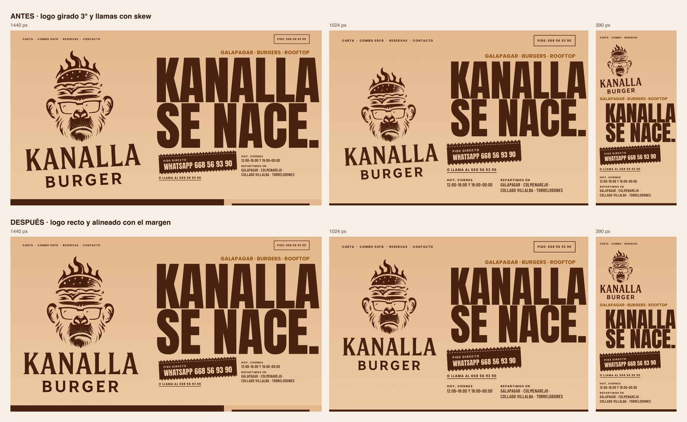

# Revisión final de la rama `web-comanda` (12 nov 2026)

Estado de la rama antes de abrir el PR. Todo lo de abajo se ha comprobado sobre el build de producción servido en local; la comanda y la validación del formulario, además, sobre la vista previa de Vercel.

## Resultado

| Comprobación | Resultado |
|---|---|
| Detector de Impeccable: código, `/`, `/reservas`, `/privacidad` y `/cookies` a 1440, 1024 y 390 | **0 hallazgos** |
| Lighthouse móvil en `/` (3 pasadas): rendimiento / accesibilidad / buenas prácticas / SEO | **97–99 / 100 / 100 / 100** (LCP 2,1 s, CLS 0) |
| Lighthouse escritorio en `/` | **100 / 100 / 100 / 100** |
| Lighthouse móvil en `/reservas` y `/privacidad` | 97 / 100 / 96–100 / 100 |
| Pruebas unitarias (`npm test`) | **20 de 20** |
| Pruebas en navegador: comanda, hoja, recarga, alérgenos, anclas, `/reservas` | **20 de 20** |
| Revisión de accesibilidad y robustez: sin JavaScript, teclado, movimiento reducido, áreas táctiles, encabezados, consola | **25 de 25** |

En `/reservas` las buenas prácticas dan 96 solo en local, porque sin `.env.local` el formulario llama a un Supabase de relleno.

## Lo que se ha corregido en esta revisión

| Hallazgo | Arreglo |
|---|---|
| En escritorio, la pestaña fija de la comanda pisaba el botón «Confirmar reserva». | La pestaña se oculta mientras el bloque de reservas está en pantalla. |
| El único test del repo era el de la plantilla de Angular y fallaba desde el primer commit. | Sustituido por 20 pruebas: comanda, mensaje de WhatsApp, Combo Sofá, guardado en el navegador, horario de hoy y datos de la carta. |
| Enlaces dentro de frases (teléfonos, «pide a domicilio», política de privacidad) con menos de 24 px de alto táctil. | Más área para el dedo sin mover el texto. «Saltar al contenido» pasa a 44 px. |
| Páginas legales: líneas de más de 85 caracteres, viudas y títulos descompensados (9 avisos del detector). | Ancho de lectura, `text-wrap: pretty` y títulos equilibrados. |

## Cambio posterior (13 nov): el logo de portada, recto

El logo del hero iba girado 3° y sus llamas se inclinaban al animarse. Ahora va recto en todos los tamaños y animaciones, con el borde izquierdo en el margen de la página y, en escritorio, la punta de las llamas a la altura del kicker. Comprobado a 1440, 1024 y 390, en reposo, durante el parpadeo y con el ratón encima: ningún `rotate`, `skew` ni `transform` inclinado en el logo, sus capas, sus pseudo-elementos ni sus contenedores.



## Qué cubren las pruebas

**Comanda (unitarias y en navegador):**

- Apuntar, sumar, quitar, vaciar y deshacer; tope de 20 unidades por línea.
- Combo Sofá: 35,00 €, la clave no depende del orden de las burgers y el ahorro nunca supera los 7 € anunciados.
- Mensaje de WhatsApp: platos, cantidades, «COMBO SOFÁ», total orientativo y «Dirección: » al final.
- Guardado: solo ids y cantidades; al recargar se recupera con los precios actuales y se descarta lo corrupto.
- Un «+» tocado antes de que cargue Angular no se pierde.
- Pedido mínimo: cubre las cuatro zonas de reparto, una sola vez cada una.

**Sin JavaScript:** se ven el titular, el logo y la carta con precios, y funcionan los enlaces de WhatsApp y teléfono.

**Teclado:** el primer foco es «Saltar al contenido» y las 52 paradas de la página tienen anillo visible.

**Movimiento reducido:** ninguna animación en marcha, ni al cargar ni al apuntar un plato.

**Formulario de reservas (en la vista previa, sin enviar nada):** carga el horario desde Supabase, marca los cinco campos obligatorios, rechaza correo y teléfono no válidos y manda al teléfono a los grupos de 10 o más.

## Pendiente antes de fusionar

1. **Migración `007_horario_oficial.sql`, sin aplicar.** El formulario lee el horario de Supabase y hoy no coincide con el que anuncia la web:

   | Día | La web dice | El formulario ofrece |
   |---|---|---|
   | Lunes | Cerrado | 19:00 a 23:00 |
   | Martes a jueves | 19:00–23:30 | 19:00 a 23:00 (coincide) |
   | Viernes y sábado | 12:00–16:00 y 19:00–00:00 | desde las 12:30 |
   | Domingo | 12:00–16:00 y 19:00–00:00 | 12:00 a 23:00 |

   Mientras no se aplique, la web dice «Los lunes descansamos» y a la vez acepta reservas para el lunes. El archivo no está en la rama, para que nada lo aplique por accidente.

2. **Reserva de prueba de principio a fin: hecha el 13 nov.** El dueño la envió desde la vista previa con su cuenta de Google. La web volvió a la vista previa, guardó la reserva y mostró «¡Reserva enviada!». Queda borrarla en Supabase (nombre «PRUEBA CLAUDE – BORRAR», lunes 16-11-2026 a las 19:00).

3. **Caso límite conocido:** si alguien cambia las burgers del Combo Sofá en los primeros segundos, antes de que cargue Angular, la selección vuelve a las de por defecto. Lo que se ve y lo que se apunta coinciden.

## Cómo repetir la revisión

```bash
cd frontend
npm test -- --watch=false     # pruebas unitarias
npm run build                 # build de producción
```

El detector se lanza como indica el `README.md` de la raíz.
